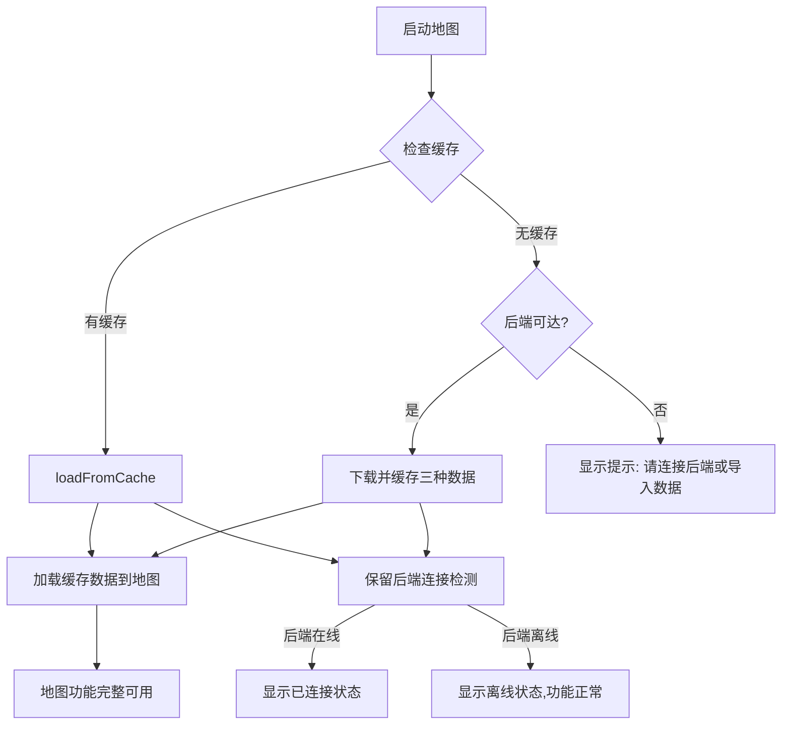

## 需求概述

手机工参地图APP当前完全依赖后端API获取数据，网络异常时无法使用。需要进行离线化改造，核心需求如下：

### 1. 首次启动自动缓存

- 用户首次打开APP连接后端时，自动缓存**全量工参**、**地理化数据**、**图层文件**三种数据到手机本地
- 缓存后无论后端是否连接，APP功能保持完整
- 保留后端连接功能，在"数据"管理页添加**数据刷新按钮**，刷新时拉取最新数据并标记日期时间戳

### 2. 数据页面改造

- 删除原"数据"页面的数据预览功能
- 原预览位置改为**数据导入功能**，支持手机上传本地文件
- 支持三种数据类型导入：全量工参、地理化数据、图层文件
- 数据格式与桌面端应用一致（Excel工参格式、Excel/CSV地理化格式、GeoJSON/MIF图层格式）

### 3. 后端只拉取更新

- 手机连接后端服务仅拉取更新全量工参、地理化数据和图层文件
- 所有数据处理逻辑在手机端独立实现（移植后端解析能力）
- 地图页面优先从本地缓存加载数据，后端仅用于更新

### 4. 分步实现要求

- 评估改造难度
- 按步骤逐步实现

## 技术方案

### 1. 技术栈选型

| 方案 | 选择 | 理由 |
| --- | --- | --- |
| 数据解析 | **SheetJS(xlsx) + PapaParse + 自定义解析器** | 与桌面端后端(openpyxl)功能对应，纯JS可在RN运行 |
| 本地存储 | **expo-file-system (文件) + AsyncStorage (索引)** | 项目中已引入，大文件存文件系统，元数据存AsyncStorage |
| 文件选择 | **expo-document-picker** | 系统级文件选择器，支持多文件、类型过滤 |
| 状态管理 | **Zustand（已有）** | 沿用现有方案，扩展缓存状态 |
| 坐标转换 | **已有 coordinate.ts** | 复用现有 WGS84↔GCJ02 转换逻辑 |


### 2. 新增依赖

```
xlsx ^0.18.5              -- SheetJS：Excel解析（与后端openpyxl对应）
expo-document-picker ~13.0.0  -- 文件选择器
papaparse ^5.4.0          -- CSV解析
```

### 3. 核心架构设计

**数据流架构：**

```
[后端API] ──(首次/刷新)──▶ [缓存服务] ──▶ [expo-file-system]
                                         │
[本地文件] ──(导入)──────▶ [数据解析引擎] ──▶ 结构化数据
  (Excel/CSV/GeoJSON/MIF)    │
                             ├─ parseFullParamsExcel() → SectorData[]
                             ├─ parseGeoDataExcel() → GeoJSON
                             ├─ parseCsvData() → GeoJSON
                             ├─ parseGeoJsonFile() → GeoJSON
                             └─ parseMifMidFile() → GeoJSON (简易解析)
```

**应用加载流程：**



### 4. 目录结构变更

```
mobile-app/
├── src/
│   ├── services/
│   │   ├── api.ts              [MODIFY] 精简后端API，新增全量数据下载端点
│   │   ├── cacheService.ts     [NEW]   本地缓存管理系统（核心模块）
│   │   ├── dataParser.ts       [NEW]   数据解析引擎（核心模块）
│   │   └── ...                 不变
│   ├── store/
│   │   └── mapStore.ts         [MODIFY] 新增缓存状态字段
│   ├── types/
│   │   └── data.ts             [NEW]   数据相关类型定义
│   ├── utils/
│   │   ├── config.ts           不变
│   │   └── coordinate.ts       不变
│   └── ...                     不变
├── app/(tabs)/
│   ├── data.tsx                [REWRITE] 数据页面彻底重写
│   ├── index.tsx               [MODIFY]  地图数据加载流程调整
│   └── ...                     不变
├── package.json                [MODIFY] 新增依赖
└── ...                         不变
```

### 5. 核心模块设计

**CacheService** - 缓存管理（src/services/cacheService.ts）

- 缓存根目录: `FileSystem.documentDirectory/cache/`
- 子目录: `fullParams/`, `geoData/`, `layers/`, `meta/`
- 核心方法:
- `init()` - 初始化目录结构
- `isFirstLaunch()` - 首次启动检测
- `getMeta()` - 获取缓存元数据（含时间戳）
- `cacheFullParamsFromBackend()` - 从后端下载全量工参并缓存
- `cacheGeoDataFromBackend()` - 从后端下载地理化数据并缓存
- `cacheLayersFromBackend()` - 从后端下载图层文件并缓存
- `getCachedSectors()` - 读取缓存的扇区数据
- `getCachedGeoDataList()` - 读取缓存的地理化数据列表
- `getCachedLayerList()` - 读取缓存的图层列表
- `importFile(uri, fileName)` - 导入本地文件到缓存
- `refreshAllFromBackend()` - 全量从后端刷新
- `clearCache()` - 清除所有缓存

**DataParser** - 数据解析引擎（src/services/dataParser.ts）
移植自后端服务的核心解析逻辑：

- `parseFullParamsExcel(arrayBuffer)` - 解析工参Excel：读取"LTE Project Parameters"/"NR Project Parameters"工作表，列映射为SectorData[]
- `parseGeoDataExcel(arrayBuffer)` - 解析地理化Excel：智能字段检测→GeoJSON FeatureCollection
- `parseCsvData(string)` - 解析CSV→GeoJSON
- `parseGeoJsonFile(string)` - 直接解析GeoJSON
- `parseMifMidFile(mifStr, midStr)` - MIF/MID文本格式解析→GeoJSON（简易实现）
- `detectFields(headers: string[])` - 字段智能识别（经纬度/方位角等）
- `convertToGcj02(features)` - 坐标转换（复用coordinate.ts）

**mapStore扩展** - （src/store/mapStore.ts）
新增状态字段：

- `cacheUpdatedAt: string | null` - 缓存更新时间
- `cacheAvailable: boolean` - 是否有可用缓存
- `cachedDataInfo: { fullParams: boolean; geoData: boolean; layers: boolean }` - 缓存的数据类型

### 6. 图层文件(MapInfo)处理策略

| 格式 | 解析方案 | 说明 |
| --- | --- | --- |
| .geojson | 直接JSON.parse | 最推荐，零依赖 |
| .mif/.mid | 手写简易解析器 | MIF是文本格式，可解析POINT/LINE/POLYGON/REGION |
| .tab | 不支持直接解析 | 二进制格式复杂，建议在桌面端预转GeoJSON后导入 |


### 7. 数据页面UI设计

```
┌──────────────────────────────────────┐
│  数据                                 │
│  上次更新: 2024-01-15 10:30:24        │
├──────────────────────────────────────┤
│  [🔄 刷新]              [📤 导入]     │
├──────────────────────────────────────┤
│  缓存数据                             │
│  ┌─ 全量工参 ───────────────────────┐ │
│  │ LTE: 120站/360小区               │ │
│  │ NR: 85站/255小区                 │ │
│  │ 缓存于: 2024-01-15 10:30        │ │
│  ├─ 地理化数据 ─────────────────────┤ │
│  │ 覆盖区域数据 (520个点)           │ │
│  │ 缓存于: 2024-01-15 10:28        │ │
│  ├─ 图层文件 ───────────────────────┤ │
│  │ 道路图层, 水系图层 (2个图层)     │ │
│  │ 缓存于: 2024-01-15 10:25        │ │
│  └──────────────────────────────────┘ │
├──────────────────────────────────────┤
│  数据导入                             │
│  支持格式: .xlsx .csv .geojson .mif  │
│  [📂 选择文件]                       │
│  或拖拽文件到此区域                   │
└──────────────────────────────────────┘
```

### 8. 难度评估

| 模块 | 难度 | 工作量 | 关键风险 |
| --- | --- | --- | --- |
| 缓存基础设施（CacheService） | 中 | 2天 | 文件路径管理、大文件IO |
| 数据解析（DataParser） | 中-高 | 3天 | MIF解析器需从零开发，字段检测逻辑移植 |
| 数据页面改造（data.tsx） | 中 | 2天 | 导入交互流程、刷新进度显示 |
| 地图数据加载调整（index.tsx） | 中 | 1天 | 离线/在线切换逻辑、缓存优先级 |
| 状态管理扩展（mapStore.ts） | 低 | 0.5天 | 新增字段和状态更新 |
| 整合调试 | 中 | 1天 | 边界情况处理、错误恢复 |
| **总计** | **中-高** | **8-9天** |  |


## 设计风格

本页面仅对"数据"页面（data.tsx）进行UI改造，采用实用清晰的信息层级设计风格：

- 信息层级清晰：顶部缓存状态 → 中部操作栏 → 缓存数据列表 → 底部导入区域
- 采用卡片式布局，每个缓存数据类型用独立卡片展示
- 状态颜色编码：绿色（已缓存）、灰色（未缓存）、蓝色（刷新中）
- 导入区域采用虚线边框拖拽式区域设计，视觉上引导用户操作
- 时间戳使用小号灰色文字，突出显示但不干扰主要信息
- 操作按钮使用圆角设计，刷新和导入按钮位置分明

## 扩展使用

### Skill

- **fullstack-dev**: 用于指导数据解析器和缓存服务的架构设计，确保与现有项目架构一致
- **code-quality-enhancer**: 在代码审查阶段使用，对新增的数据解析模块和缓存模块进行质量把关

### SubAgent

- **code-explorer**: 在实施阶段进一步深入探索后端数据处理逻辑的细节（data_service.py、geo_data_service.py、geo_field_detector.py、mapinfo_service.py），确保解析逻辑移植的完整性和正确性